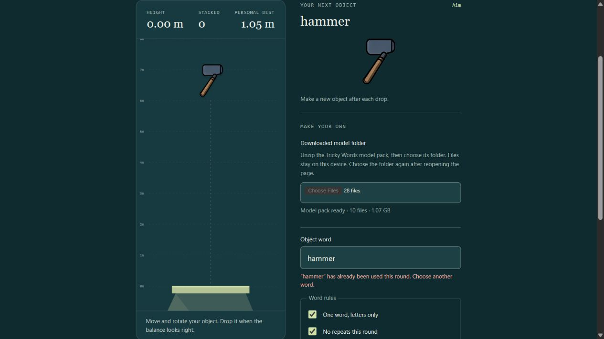
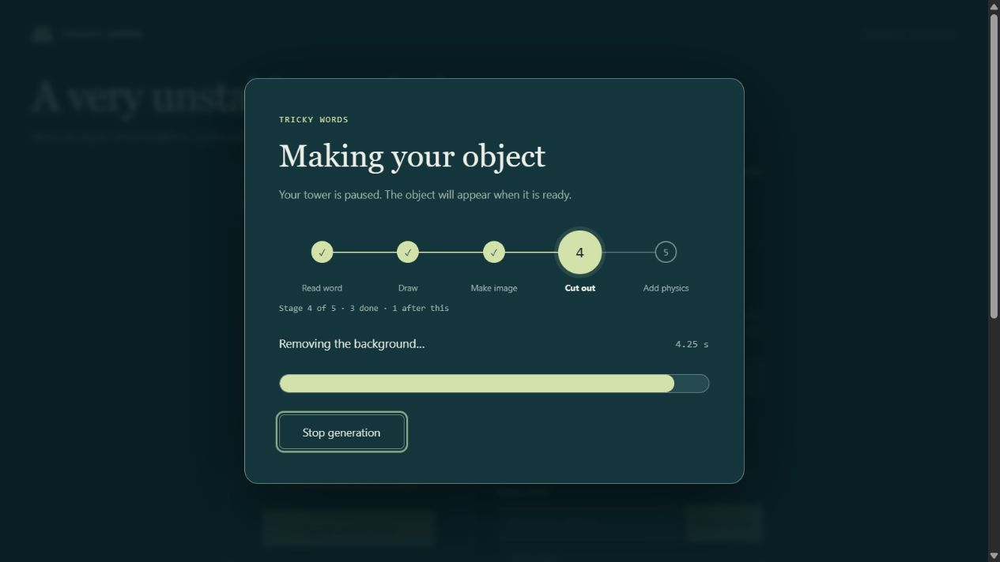

# Tricky Words

Name an object, let the AI draw it, then balance it on a growing tower. Each piece gets a transparent sprite and a collision shape from its generated image. Lose an object and the round ends.

The game and AI inference run locally through the browser. There is no inference API, account, paid service or upload of player words and images.

[Download the 8-bit preview](https://github.com/LuBolin/TrickyWords/releases/tag/v0.1.0-alpha.2) · [Developer guide](docs/DEVELOPMENT.md) · [Benchmarks](docs/BENCHMARKS.md) · [Credits and model licenses](THIRD_PARTY.md)



## Download and play

This is an **experimental preview**. The self-contained package has passed Windows Chromium tests over local HTTP. Direct double-click opening, macOS and the final Firefox package have not yet been verified. Treat the download as a preview for testing.

1. Open the [release page](https://github.com/LuBolin/TrickyWords/releases/tag/v0.1.0-alpha.2) and download **TrickyWords.zip**. GitHub's automatically generated **Source code** archives do not contain the prepared game or model weights.
2. Extract the whole ZIP. Keep its files together.
3. Open **TrickyWords/index.html** in a browser with WebGPU and `shader-f16` support.
4. Choose the included **models** folder, then click **Load AI models**. First setup checks the browser, selects a background-removal runtime, loads the models and warms them.
5. Type an **Object word** and click **Make object** beside it. Move, rotate and drop the generated piece.

The player package contains HTML, four JavaScript files, model files and license notices. Its browser-only launch is designed to need no installer, command window, Python, Node.js or local server. Files stay on the device. Choose the model folder again after refreshing or reopening the page; browsers do not silently grant access to neighboring model files.

The download uses **8-bit constant matrix and embedding weights**, with FP16 remaining weights and activations and original FP32 attention. The ZIP is **1.509 GB**, with **1.677 GB** of model files after extraction. It fits in one GitHub Release asset. The repository keeps weights out of Git history; GitHub supplies the complete player download, with no separate model host. A `SHA256SUMS.txt` file accompanies the release for optional integrity checks. Replace the complete game folder when upgrading from the earlier 4-bit preview.

## Controls

| Action | Mouse | Keyboard |
| --- | --- | --- |
| Move horizontally | Move over the playfield | Hold **A / D** or **left / right arrows** |
| Rotate | Scroll over the active piece | **Q / E** |
| Drop | **Left click** the playfield | **S / Space** or **down arrow** |
| Pause or resume | Pause / Resume button | **P / Escape** |

Keyboard movement takes over until the mouse moves again. You can steer and rotate a falling piece until it touches the tower. Typing in the word or seed fields does not trigger game controls. On-screen move, rotate and drop buttons are also available.

The playfield is a tall 480 × 880 portrait area. The camera follows taller towers, and your best height is saved in the browser when local storage is available. Hiding the page or changing focus pauses the game.

## Generation and rules

The default rules allow **one word, letters only**, and **no repeated words in the current round**. Both can be switched off. Letters in non-English languages are accepted. Repeat checks ignore capitalization and Unicode composition. Failed or stopped attempts do not consume a word. Restarting clears the round's word history while keeping the models loaded.

Generation pauses the tower. A centered panel shows five connected stages: **Read word → Draw → Make image → Cut out → Add physics**. Completed circles get checkmarks, the current circle grows larger, and the text below shows details such as `step 3 / 8`, elapsed time and how many stages remain. **Stop generation** cancels safely after the current operation.



Toggle **Show collision shapes** to see the actual physics fixtures. Expand **Generation images, collision shapes and performance** for the original image, transparent PNG, polygon preview, timings and a downloadable diagnostic report.

## Device requirements and known limits

- A desktop browser exposing **WebGPU** and **`shader-f16`** is required. Chrome and Edge are the main development targets. Hardware acceleration must be available.
- **16 GB of system RAM and a recent GPU** are the intended target, not a verified minimum. The 8-bit pack has completed generation and collision tracing on an RTX 4060 Laptop GPU and Intel UHD Graphics. Both GPUs were tested in a computer with 64 GB RAM; physical 16 GB and 8 GB configurations remain untested. Shared GPU memory uses system RAM.
- Model file size is not the runtime memory requirement. Setup needs additional CPU and GPU memory. Other GPU applications can affect speed and available memory.
- The release uses 512 × 512 generation with eight diffusion steps. Measured median object times were **4.27 seconds on RTX 4060** and **34.81 seconds on Intel UHD**. These are observations from one computer, not guarantees. Setup takes substantially longer than generating later pieces. See [benchmark methods and limits](docs/BENCHMARKS.md).
- AI can draw the wrong object, multiple objects or a poor side view. Background removal and collision tracing can fail. Collision shapes keep the largest connected silhouette and fill enclosed holes, so visible openings are not always physical openings.
- This is a single-player stacking prototype. It has no multiplayer or remote generation service.

If setup fails, expand **Device details and run log** and save the diagnostic report. Report the browser, GPU if known, launch method and full error in [Issues](https://github.com/LuBolin/TrickyWords/issues). Reports can include your word, seed and device information; inspect them before posting publicly.

## Development

The source is in `public/`, with model conversion and packaging tools in `scripts/`. Node.js dependencies are pinned in `package-lock.json`. Source checkout and model preparation are separate from the player download.

```sh
npm ci --ignore-scripts
npm test
npm run prepare-runtime
```

After copying the prepared release weights into `public/models/`, developers can use `python server.py` for the source preview, or `npm run build-download` and `python scripts/package-download.py` to rebuild the download. The optional development server only serves static files on `127.0.0.1:8765`; AI work stays in the browser. Stop it with **Ctrl+C**.

See [docs/DEVELOPMENT.md](docs/DEVELOPMENT.md) for the model file list, export steps, build layout and verification limits. The JavaScript suite currently has **41 tests**. Heavy model checks are separate and require local model exports and Python dependencies.

## Credits and licensing

Image generation uses **[Mobile-O](https://github.com/Amshaker/Mobile-O)** by **Abdelrahman Shaker and collaborators**, from the [Mobile-O-0.5B checkpoint](https://huggingface.co/Amshaker/Mobile-O-0.5B). The browser conversion changes precision, graph layout and packaging. Mobile-O model materials and these model adaptations retain **CC BY-NC-SA 4.0**. Commercial use requires the authors' permission under their stated terms. A zero price alone does not make every use non-commercial.

Background removal uses **BiRefNet**, inference uses **ONNX Runtime Web**, tokenization uses **Hugging Face Tokenizers.js**, and physics uses **Matter.js**. Their notices and licenses are included. See [THIRD_PARTY.md](THIRD_PARTY.md) for sources, revisions, modifications and the Mobile-O paper citation, and [LICENSE.md](LICENSE.md) for the repository's licensing scope. This project is independent of those projects and does not imply their endorsement.
